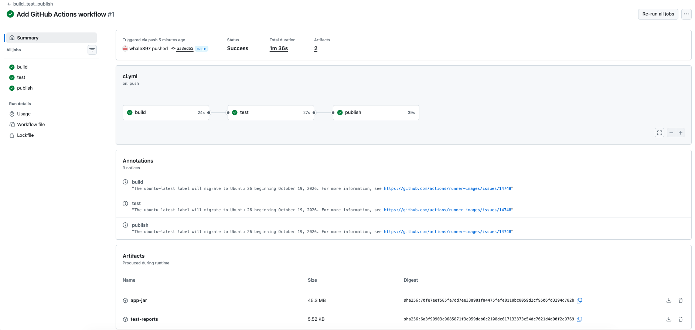
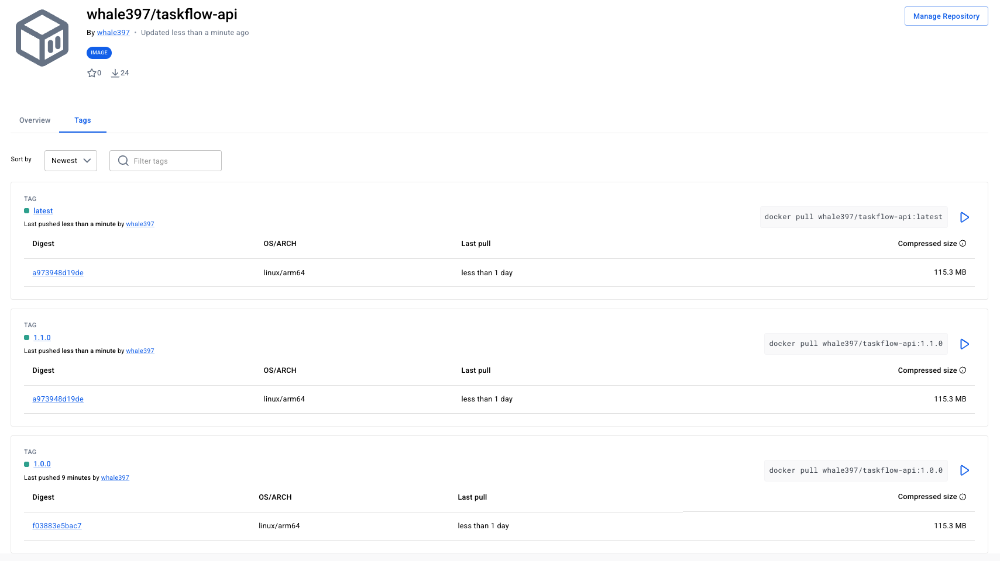

## Assignment Submission

### Live Application URL

https://dazzling-growth-production-90de.up.railway.app/api/tasks

### Screenshot: Railway Dashboard

### Screenshot: Live Application

### Errors and Failures

None. All four mandatory tasks completed successfully.

## Stretch Goal 1: CI Pipeline

Implemented a GitHub Actions CI pipeline based on Lesson 4.9.

The pipeline automatically runs on every push to `main`:

1. **Build** — Compile and package the Spring Boot application.
2. **Test** — Run automated tests.
3. **Publish** — Build and push the Docker image to Docker Hub.

All three jobs completed successfully.

[GitHub Actions Workflow](https://github.com/whale397/taskflow-api/actions/runs/40177342805)

[Docker Hub Repository](https://hub.docker.com/r/whale397/taskflow-api)

## Stretch Goal 4: Versioned Docker Images

Docker Hub: https://hub.docker.com/r/whale397/taskflow-api

Published versions:
- `1.0.0` — Initial release
- `1.1.0` — Updated application configuration
- `latest` — Most recent image published by the CI pipeline

Images use `MAJOR.MINOR.PATCH` versioning.

The `latest` tag is automatically updated by GitHub Actions on every successful CI run.

